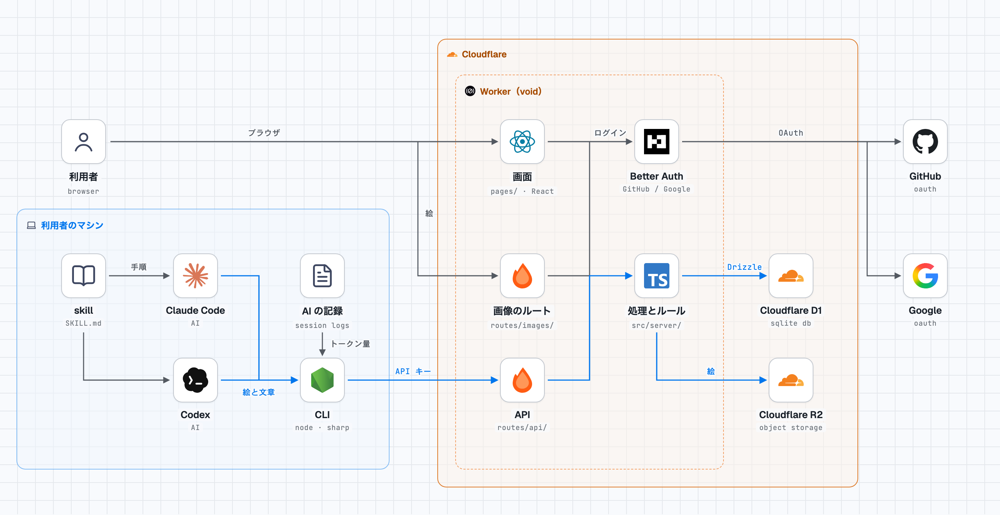
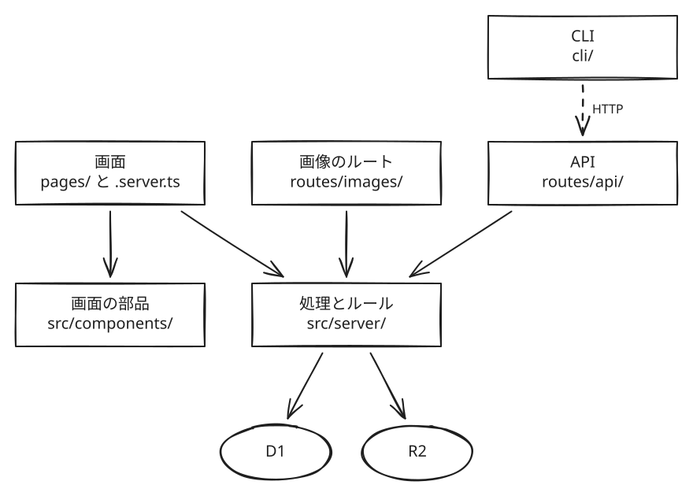
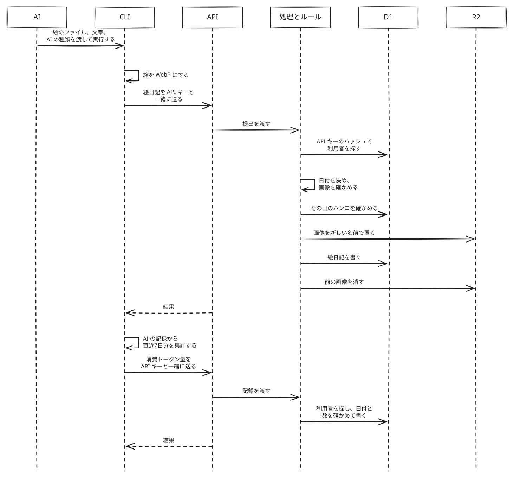
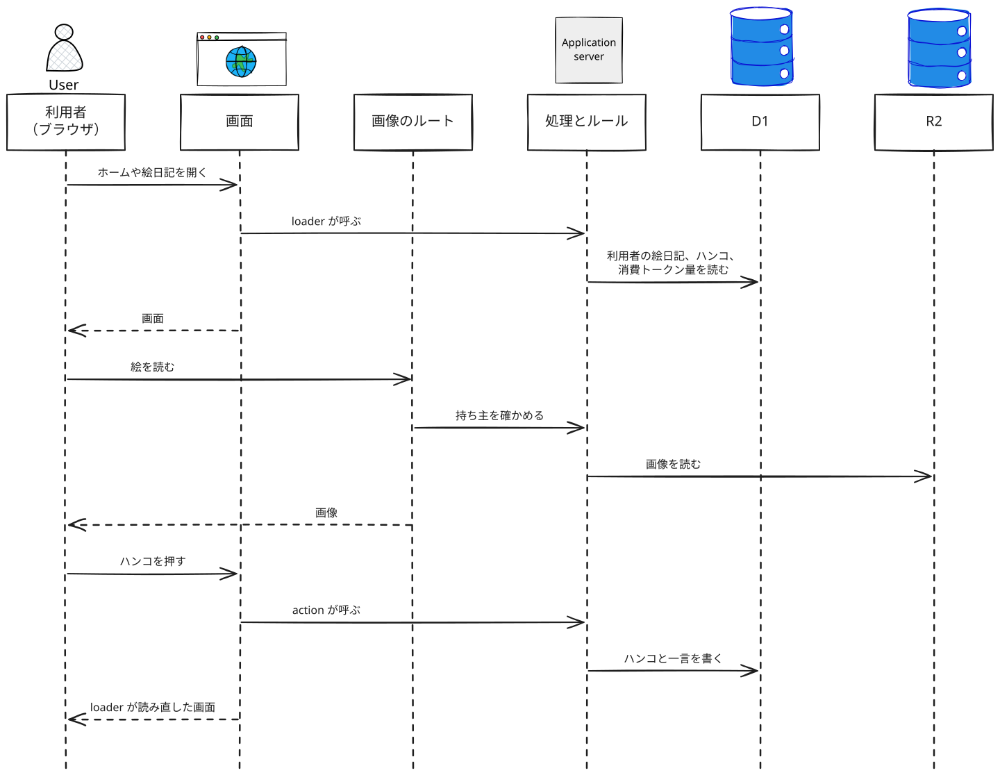

# システム構成（アーキテクチャ）

「AI が書く絵日記」を何で作り、どこで動かし、部品ごとに何を受け持つかをまとめる。ルールは [ドメイン](domain-model.md)、利用者と AI がすることは [ユースケース](use-cases.md) に書いてある。

## 1. 全体構成と責務

### 構成図



### 部品と責務

| 部品         | 受け持つこと                                                                                        |
| ------------ | --------------------------------------------------------------------------------------------------- |
| 画面         | ログイン、ホーム、絵日記、API キーの4つの画面。データは、画面と対になる `.server.ts` で読み書きする |
| 画面の部品   | ハンコ、カレンダー、グラフなど。データは props で受け取る                                           |
| 画像のルート | ログインしている利用者に、その人の絵日記の絵を返す                                                  |
| API          | CLI からの提出と消費トークン量の記録を受け付ける。HTTP の受け渡しだけをする                         |
| 処理とルール | [ドメイン](domain-model.md) のルールと、画面、画像のルート、API から呼ぶ処理                        |
| ログイン     | GitHub と Google でのログイン。void が Better Auth を設定する                                       |
| CLI          | API キーの保存、絵の変換、消費トークン量の集計、提出                                                |
| skill        | AI に絵の描き方と提出の手順を伝える。Claude Code 用と Codex 用に分ける                              |

### 依存の向き



呼び出しは矢印の向きだけにする。守る決まりは「2. 設計判断と不変条件」にまとめる。

## 2. 設計判断と不変条件

### 使う技術

| 分類                   | 使うもの                          | 選んだ理由                                                                     |
| ---------------------- | --------------------------------- | ------------------------------------------------------------------------------ |
| 言語                   | TypeScript                        | void で、API の型を画面からの呼び出しまで確かめられる                          |
| フレームワーク         | void                              | 画面と API を1つの Worker に置き、DB、画像、ログイン、デプロイもまとめて扱える |
| フロントエンド         | React                             | void のドキュメントの例はほとんどが React で書かれていた                       |
| バックエンド           | Hono                              | void のルーティングが Hono で動く                                              |
| データベース           | Cloudflare D1                     | void の既定のデータベース                                                      |
| ORM                    | Drizzle                           | void に組み込まれている                                                        |
| ストレージ             | Cloudflare R2                     | 画像は D1 に入らない                                                           |
| 認証                   | Better Auth（GitHub、Google）     | void が設定する                                                                |
| ホスティング           | Cloudflare Workers（Free プラン） | 自分の Cloudflare アカウントで動き、void にお金を払わない                      |
| CLI                    | Node.js                           | npm で配れ、sharp を使える                                                     |
| 画像処理               | sharp                             | SVG を画像にし、WebP にできる                                                  |
| 配布                   | npm                               | `npm i -g` で入れられ、skill も一緒に配れる                                    |
| パッケージマネージャー | pnpm                              | Web と CLI を1つの workspace でまとめる                                        |
| ビルドツール           | Vite+（`vp`）                     | void の既定のビルドツール                                                      |

### 不変条件

- D1 と R2 を読み書きするのは `src/server/adapter/` だけにし、必ず利用者で絞る
- `src/server/domain/` は `usecase/`、`adapter/`、`db/schema.ts`、Drizzle を import しない。D1 から読んだ値は `adapter/` で schema に通してからドメインの型にする
- API に届く値は、CLI が送ったものでもすべて確かめる
- API を変えるときは、古い CLI からの提出も受け付ける。利用者のマシンには古い CLI が残るためだ
- マイグレーションは後方互換にする。デプロイではマイグレーションが新しいコードより先に当たり、失敗しても戻らないためだ

## 3. コードの配置と実装の入口

Web と CLI は同じリポジトリに置き、pnpm の workspace でまとめる。1人で作り、API と CLI を一緒に変えることが多いためだ。void はコマンドを実行したフォルダをプロジェクトのルートとして扱うので、`web/` に置いても動く。`void.config.ts`、`.env`、`void.lock.json` は `web/` に置かれる。

```
.
├── docs/                 ドキュメント
├── web/                  Web のアプリ（void）
│   ├── pages/            画面（React）と、対になる .server.ts
│   ├── routes/api/       API
│   ├── routes/images/    絵を返すルート
│   ├── src/components/   画面の部品
│   ├── src/server/       処理とルール
│   │   ├── domain/       ドメインの型と、状態を変える関数
│   │   ├── usecase/      提出やハンコを押すときの処理の手順
│   │   └── adapter/      D1 と R2 の読み書きの実装
│   ├── db/schema.ts      D1 の表
│   ├── db/migrations/    マイグレーション（void db generate が作る）
│   └── void.config.ts    void とログインの設定
├── cli/                  CLI（npm で配る）
│   ├── src/              CLI のコード
│   ├── claude/skills/    Claude Code に渡す skill
│   └── codex/skills/     Codex に渡す skill
├── pnpm-workspace.yaml   workspace の設定（web と cli）
└── package.json
```

`src/server/` の中は 関数型ドメインモデルの層ごとに分けるディレクトリ構成とする

- `domain/`: 絵日記、ハンコ、API キー、消費トークン量の型と、状態を変える関数を置く。D1 と R2 は読み書きしない。「その日の絵日記を読む」「絵日記を保存する」のような読み書きの型（resolver と store）もここに置き、実装は `adapter/` に置く
- `usecase/`: 読み書きの型を通して値を読み、`domain/` の関数に渡し、返ってきた状態を保存する。画面の `.server.ts`、画像のルート、API はここを呼ぶ
- `adapter/`: `domain/` の読み書きの型を D1 と R2 で実装する。HTTP を受けるのは `pages/` の `.server.ts` と `routes/` なので、ここには D1 と R2 の実装だけを置く

Web の URL は、void が `pages/` と `routes/` の下のファイルの場所から決める。実装の入口は次のとおり。

| 入口                                        | 動くとき                                                               |
| ------------------------------------------- | ---------------------------------------------------------------------- |
| `web/pages/*.server.ts` の loader と action | ブラウザが画面を開いたとき（loader）と、フォームを送ったとき（action） |
| `web/routes/images/`、`web/routes/api/`     | ブラウザや CLI が HTTP で呼んだとき                                    |
| `web/void.config.ts`                        | 開発用のサーバーを起動したときと、ビルドとデプロイのとき               |
| `web/db/schema.ts`                          | `void db generate` でマイグレーションを作るときと、デプロイのとき      |
| `cli/package.json` の `bin`                 | AI が CLI を実行したとき                                               |

## 4. 主要データと内部表現

### データ一覧

| データ             | 中身                                                             | 保存先                                                                      |
| ------------------ | ---------------------------------------------------------------- | --------------------------------------------------------------------------- |
| 利用者とセッション | GitHub か Google のアカウントと結びつく利用者と、ログインの状態  | D1（Better Auth の表）と、ブラウザの Cookie                                 |
| API キー           | 利用者ごとに1つ。サーバーが作り、作ったときに1度だけ画面に見せる | D1 には SHA-256 のハッシュだけを置く。キーは CLI が利用者のマシンに保存する |
| 絵日記             | 日付、文章、AI の種類、絵の名前、ハンコ、一言                    | D1                                                                          |
| 絵                 | WebP の画像                                                      | R2                                                                          |
| 消費トークン量     | 利用者、AI の種類、日付ごとの4つの数                             | D1                                                                          |
| AI の記録          | Claude Code と Codex のセッションのファイル                      | 利用者のマシン                                                              |

D1 と R2 のデータはどれも1人の利用者のもので、持ち主の利用者だけが読める。

### 内部表現

- 日付はどれも日本時間の日付にする。絵日記の日付はサーバーが決め、消費トークン量の日付は CLI が送る
- 消費トークン量の4つの数（入力、キャッシュ書き込み、キャッシュ読み込み、出力）は、どの AI の種類でも同じ意味にそろえる

| データ         | 形の変わり方                                                                                    |
| -------------- | ----------------------------------------------------------------------------------------------- |
| 絵             | AI が作った SVG、PNG、JPEG、WebP → CLI が長い辺 2,048 px 以内の WebP にする → R2                |
| 消費トークン量 | AI の記録 → CLI が日本時間の日付ごとに足した4つの数 → D1 → キャッシュ読み込みを除いた和のグラフ |

## 5. 代表的な処理の流れ

### ログインと API キー

- ログインでは、Better Auth が利用者を GitHub か Google に送る。戻ってきたらセッションを D1 に作り、Cookie に入れる。初めてログインしたときは、利用者も D1 に作る
- 画面と画像のルートは Cookie のセッションから、API は API キーのハッシュから利用者を決める
- API キーを作り直すと D1 のハッシュが置きかわり、古いキーは使えなくなる

### 絵日記を提出し、消費トークン量を記録する



- サーバーは画像を変換せず、先頭のバイトで形式を確かめる。5 MB か長い辺 2,048 px を超えるものは断る
- 消費トークン量はハンコが押された日の分も置きかわるので、CLI は絵日記が断られたときも消費トークン量を送る
- D1 と R2 への書き込みはまとめて取り消せない。そのため、絵は提出ごとに新しい名前で R2 に置き、D1 に書けたら前の絵を消す。D1 に書けなかったときは、置いた絵を消す。こうすると、ハンコを押した絵日記の絵が差し替わらない
- 消費トークン量は1行ずつの書き込みを `db.batch()` でまとめて送る。`db.batch()` は1つでも失敗するとすべてを取り消すので、一部の日付だけが書かれることはない

入力の確かめ方と、断るときの返し方は API の設計で決める。

### 画面で見る、ハンコを押す



画面はログインしている利用者のデータだけを読む。ハンコと一言を action で書いたあとは、loader がもう一度動いて画面が新しくなる。

## 6. 拡張・変更の方法

変更は本番にだけデプロイする。void には PR ごとのプレビューも staging もないので、手元で動かして確かめてから出す。

| 変えたいこと                              | 変える場所                                                                      | 気をつけること                                                                                                                                                  |
| ----------------------------------------- | ------------------------------------------------------------------------------- | --------------------------------------------------------------------------------------------------------------------------------------------------------------- |
| AI の種類を足す                           | ドメイン、`src/server/`、`db/schema.ts`、CLI の記録の読み方、`cli/<AI>/skills/` | 4つの数の意味をそろえる（4章）                                                                                                                                  |
| API を変える                              | `routes/api/`、`src/server/`、CLI                                               | 古い CLI からの提出も受け付ける（2章）。新しい CLI が要る変更では、先に Web をデプロイし、そのあとで CLI を公開する                                             |
| D1 の表を変える                           | `db/schema.ts` とマイグレーション                                               | マイグレーションは後方互換にする（2章）。列を消すのは、その列を使うコードを消したあとのデプロイにする                                                           |
| Claude Code や Codex の記録の形が変わった | CLI の記録の読み方                                                              | サーバーは変えない。要る項目がない行は飛ばす                                                                                                                    |
| 画面を足す                                | `pages/`、`src/components/`、`src/server/`                                      | データは `.server.ts` の loader で読む                                                                                                                          |
| MCP から提出する                          | `routes/` の下の新しい入口                                                      | 処理は `src/server/` の同じ関数を呼ぶ                                                                                                                           |
| AI がハンコと一言を受け取る               | `routes/api/`、`src/server/`、CLI                                               | API キーで読めるのは、そのキーの利用者の絵日記だけにする                                                                                                        |
| void を上げる                             | `web/package.json`                                                              | `^` を付けずに正確なバージョンで固定する。リリースノートと開いている不具合を読んでから1つの PR で上げ、手元でログイン、提出、絵の表示を確かめてからデプロイする |
