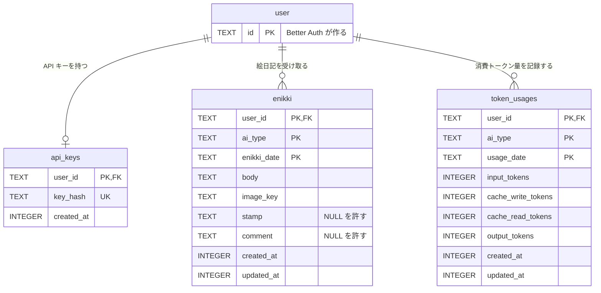
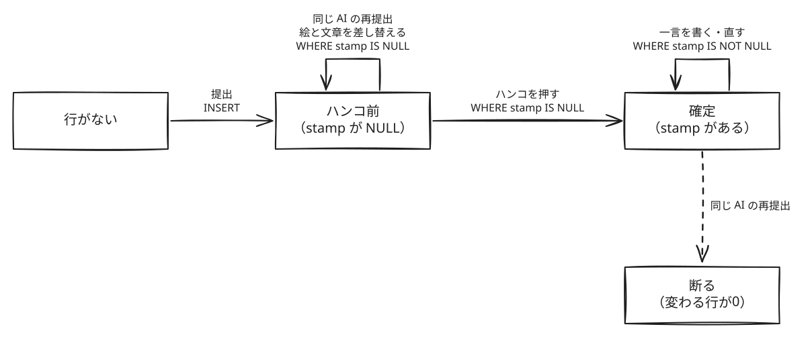
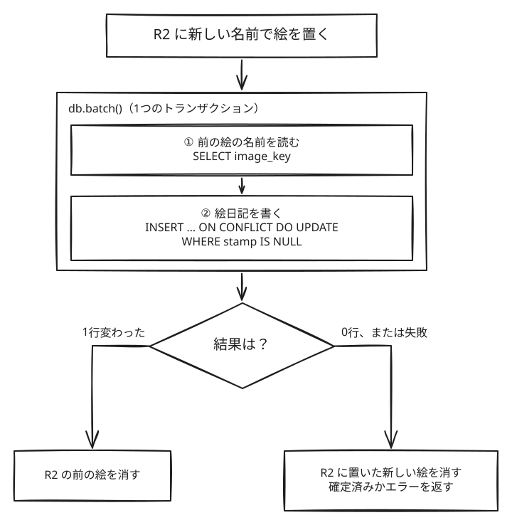
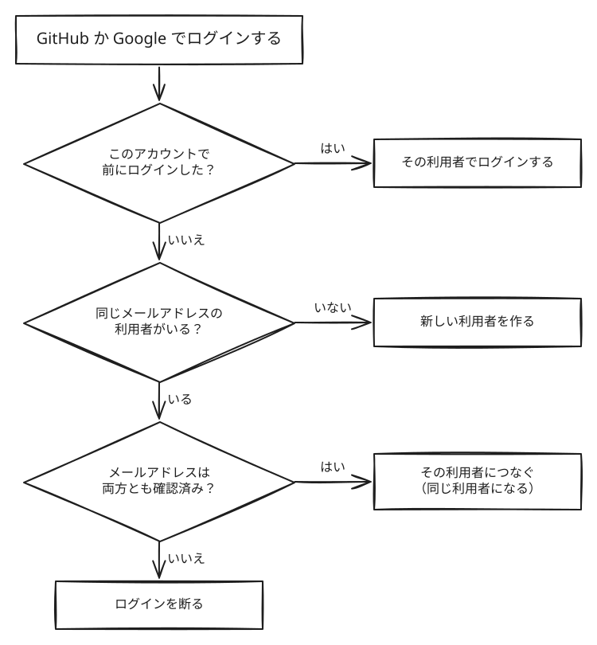

# DB の設計

D1 の表と R2 の絵の置き方をまとめる。ルールは [ドメイン](domain-model.md)、全体の構成は [システム構成](architecture.md) に書いてある。

## 1. 表の一覧と ER 図



| 表             | 1行が表すもの                                               | 作るもの            |
| -------------- | ----------------------------------------------------------- | ------------------- |
| `api_keys`     | 利用者ごとに1つの API キー                                  | アプリ              |
| `enikki`       | 利用者と AI の種類ごとの1日分の絵日記。ハンコと一言も入れる | アプリ              |
| `token_usages` | 利用者、AI の種類、日付ごとの消費トークン量                 | アプリ              |
| `user` など    | 利用者、セッション、ログインに使ったアカウント              | void（Better Auth） |

名前は英語の複数形とスネークケースにする。絵日記だけはどこでも `enikki` と書き、複数形にしない。Better Auth の表は、void が作る名前のまま（単数形、キャメルケース）にする。

## 2. テーブル定義

型は SQLite の型にする。日付は日本時間の暦の日付で、日時は UTC の Unix 時刻（ミリ秒）で持つ。瞬間を日本時間の日付にする変換は、1つの関数にまとめる。外部キーには `ON DELETE` を付けない（既定の `NO ACTION`）。そのため、子の行が残っている利用者の行は消せない。実装したあとは `web/db/schema.ts` を正しいものとし、この表とずれたら表を直す。

### api_keys

| カラム     | 型      | 制約              | 説明                                                                   |
| ---------- | ------- | ----------------- | ---------------------------------------------------------------------- |
| user_id    | TEXT    | PK, FK → user(id) | Better Auth の `user.id`（英字と数字の32文字）。利用者ごとに1つ        |
| key_hash   | TEXT    | NOT NULL, UNIQUE  | キーの SHA-256 を base64url にした43文字。**キーそのものは保存しない** |
| created_at | INTEGER | NOT NULL          | 今のキーを作った日時。作り直すと更新する                               |

### enikki

| カラム      | 型      | 制約              | 説明                                                                                              |
| ----------- | ------- | ----------------- | ------------------------------------------------------------------------------------------------- |
| user_id     | TEXT    | PK, FK → user(id) |                                                                                                   |
| ai_type     | TEXT    | PK                | `claude_code` / `codex`。CHECK にせず、ドメインの型で守る（AI の種類は増える前提）                |
| enikki_date | TEXT    | PK                | 日本時間の暦の日付（`2026-11-07`）。サーバーが決める                                              |
| body        | TEXT    | NOT NULL          | 文章                                                                                              |
| image_key   | TEXT    | NOT NULL          | R2 の絵の名前（6章）                                                                              |
| stamp       | TEXT    | CHECK             | `smile`（にっこり）/ `neutral`（真顔）/ `disappointed`（残念な顔）。**NULL ならまだ押していない** |
| comment     | TEXT    | CHECK             | 一言。**ハンコを押したあとでないと書けない**                                                      |
| created_at  | INTEGER | NOT NULL          | 最初に提出された日時                                                                              |
| updated_at  | INTEGER | NOT NULL          | 提出、ハンコ、一言のどれかで最後に変わった日時                                                    |

### token_usages

| カラム             | 型      | 制約              | 説明                                                    |
| ------------------ | ------- | ----------------- | ------------------------------------------------------- |
| user_id            | TEXT    | PK, FK → user(id) |                                                         |
| ai_type            | TEXT    | PK                | `claude_code` / `codex`                                 |
| usage_date         | TEXT    | PK                | 日本時間の暦の日付。CLI が送る                          |
| input_tokens       | INTEGER | NOT NULL, CHECK   | 入力。整数で0以上                                       |
| cache_write_tokens | INTEGER | NOT NULL, CHECK   | キャッシュ書き込み。整数で0以上                         |
| cache_read_tokens  | INTEGER | NOT NULL, CHECK   | キャッシュ読み込み。整数で0以上。グラフの和には入れない |
| output_tokens      | INTEGER | NOT NULL, CHECK   | 出力。整数で0以上                                       |
| created_at         | INTEGER | NOT NULL          | 最初に記録した日時                                      |
| updated_at         | INTEGER | NOT NULL          | 最後に記録した日時                                      |

## 3. ルールを守る場所

| ルール                                                   | 守る場所 | 書き方                         |
| -------------------------------------------------------- | -------- | ------------------------------ |
| 絵日記は利用者と AI の種類ごとに1日1件まで               | DB       | `enikki` の主キー              |
| 消費トークン量は利用者、AI の種類、日付ごとに1件         | DB       | `token_usages` の主キー        |
| API キーは利用者ごとに1つ                                | DB       | `api_keys` の主キー            |
| どの行にも持ち主の利用者がいる                           | DB       | 外部キー                       |
| ハンコは3種類のどれか                                    | DB       | CHECK                          |
| 一言はハンコを押したあとでないと書けない                 | DB       | CHECK                          |
| 消費トークン量の4つの数は0以上の整数                     | DB       | CHECK（`typeof` と `>= 0`）    |
| AI の種類は Claude Code か Codex                         | 処理     | ドメインの型                   |
| ハンコは押したら変えられず、確定した絵日記への提出は断る | 処理     | 書き込みの条件（4章）          |
| 消費トークン量は直近7日分だけで、未来の日付は記録しない  | 処理     | CHECK では今日の日付を使えない |
| 絵日記の日付はサーバーが決める                           | 処理     |                                |
| 絵日記は削除できない                                     | 処理     | 削除する処理を作らない         |

DB にも書くのは、次の3つすべてに当てはまる決まりだけにする。AI の種類は増える前提なので、CHECK にしない。

- ドメインが変わっても変わらない
- 破られてもエラーにならず、気づきにくい
- その行の値だけで判断できる

## 4. 書き込みの条件



| 操作                     | 書き方                                                                   | 条件                                                                    |
| ------------------------ | ------------------------------------------------------------------------ | ----------------------------------------------------------------------- |
| 絵日記を提出する         | `INSERT … ON CONFLICT DO UPDATE`                                         | ハンコが NULL のときだけ更新する。変わった行が0なら、確定済みとして断る |
| ハンコを押す             | `UPDATE`                                                                 | `stamp IS NULL`                                                         |
| 一言を書く・直す         | `UPDATE`                                                                 | `stamp IS NOT NULL`                                                     |
| 消費トークン量を記録する | `INSERT … ON CONFLICT DO UPDATE` を行ごとに書き、`db.batch()` でまとめる | なし。いつも新しい値に置きかえる                                        |
| API キーを作る・作り直す | `INSERT … ON CONFLICT DO UPDATE`                                         | なし。`key_hash` と `created_at` を置きかえる                           |

ハンコの確認と書き込みは、1つの SQL の中で行う。SELECT で確かめてから書くと、そのあいだにハンコが押された絵日記を書き換えてしまうためだ。



## 5. 読み方と索引

| 読み込み                                 | 条件                                        | 使う索引                | 読む先         |
| ---------------------------------------- | ------------------------------------------- | ----------------------- | -------------- |
| ホームの1週間のハンコ、カレンダーの1か月 | `user_id`、`ai_type`、`enikki_date` の範囲  | `enikki` の主キー       | レプリカでよい |
| 絵日記を開く                             | `user_id`、`ai_type`、`enikki_date`         | `enikki` の主キー       | レプリカでよい |
| 前後の絵日記へめくる                     | `enikki_date` の前後を `ORDER BY … LIMIT 1` | `enikki` の主キー       | レプリカでよい |
| ホームの1週間の消費トークン量            | `user_id`、`ai_type`、`usage_date` の範囲   | `token_usages` の主キー | レプリカでよい |
| API キーで利用者を探す                   | `key_hash`                                  | `key_hash` の一意制約   | プライマリ     |

新しい索引は足さない。API キーを探すときだけプライマリから読むのは、作り直す前の古いキーを、遅れたレプリカで受け付けないためだ。void の文書どおり、`cloudflare:workers` の `env.DB` を `withSession('first-primary')` で使う。

## 6. R2 の絵の名前

```
{user_id}/{ai_type}/{enikki_date}/{crypto.randomUUID()}.webp
```

提出ごとに新しい名前にする。退会を作るときは、その人の3つの表の行と、`{user_id}/` で始まる絵を消してから、利用者の行を消す。

## 7. 利用者の扱い

GitHub と Google の両方でログインした人は、Better Auth の既定のまま扱う。



## 8. マイグレーション

| 段階                  | すること                                                             | void の動き                                                                              |
| --------------------- | -------------------------------------------------------------------- | ---------------------------------------------------------------------------------------- |
| 1. 手元で試す         | `web/db/schema.ts` を書き、`void db push` を実行する                 | 手元の D1 にそのまま当てる。マイグレーションのファイルは作らない                         |
| 2. SQL を作る         | `void db generate` を実行する                                        | 前回の状態と比べて、`web/db/migrations/` に SQL を作る。Better Auth の表も入る           |
| 3. 読んでコミットする | 作られた SQL を読む                                                  | 今あるデータが残るかは、void は確かめない                                                |
| 4. デプロイする       | `void deploy` を実行する                                             | 復元点を保存し、マイグレーションを当ててから、新しいコードを出す                         |
| 5. 失敗したら戻す     | `void project rollback` と `void db restore --bookmark …` を実行する | コードと DB を戻す。復元点よりあとの書き込みは消える。戻せるのは7日前まで（Free プラン） |

マイグレーションは新しいコードより先に当たるので、前のバージョンのコードでも動く形にする。

| 変えたいこと | SQLite での変わり方                                            | 決まり                                         |
| ------------ | -------------------------------------------------------------- | ---------------------------------------------- |
| 列を足す     | `ALTER TABLE … ADD COLUMN`                                     | NULL を許すか、既定値を付ける                  |
| 列を消す     | `ALTER TABLE … DROP COLUMN`                                    | その列を使うコードを消したデプロイのあとにする |
| 制約を変える | 表を作り直す（新しい表に行を写し、古い表を消して名前を変える） | `ALTER TABLE` では制約を変えられない           |

3で SQL を読むときは、とくに `DROP TABLE` を確かめる。D1 はいつも外部キーを守るので、表を消すと、先にその表の行がすべて DELETE される。`user` の表を消す SQL は、3つの表の行が `user` を指しているので、外部キーのエラーで止まる。`user` の表を作り直す必要があるときは、そのマイグレーションの先頭に `PRAGMA defer_foreign_keys = on;` を書き、外部キーの確認をトランザクションの終わりまで遅らせる。

## 9. 実装で確かめること

- `db/schema.ts` から、void が作る `.void/better-auth-schema.ts` の `userTable` を読み込み、外部キーを書けるか。書けなければ、マイグレーションの SQL に手で書くか、外部キーをやめて処理で守るかを決め直す
- Drizzle が作る SQL が、2章の定義と合っているか。とくに主キーの列の `NOT NULL` と CHECK
- 表を作り直すマイグレーションで Drizzle が作る SQL が、外部キーを守ったままの D1 で動くか。D1 では `PRAGMA foreign_keys` を変えられない
