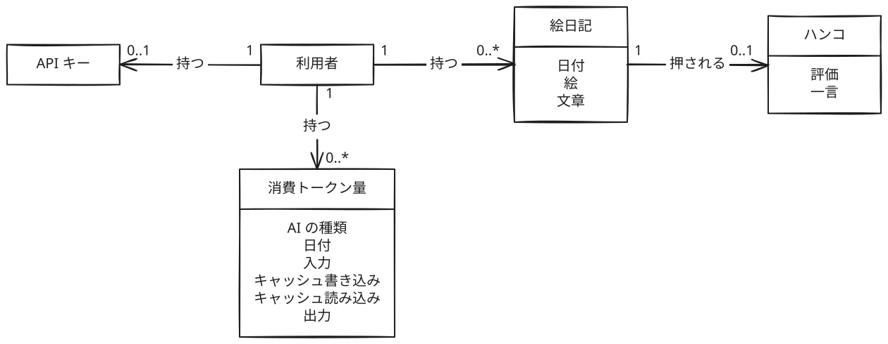

# ドメイン

「AI が書く絵日記」のビジネスルールとドメインモデル図をまとめる。

## このドメインを選んだ主な理由

- 毎日一緒に作業している AI を相棒のように感じていて、その AI から見た1日を知りたい。絵日記にハンコを押して、AI に評価を返せるようにもしたい
- AI と過ごした1日を、作業の記録ではなく子どもの頃の絵日記のような楽しい形で残したい
- CLIを実装してAIから操作できるWEBアプリを作成したかった

## 用語

| 用語           | 意味                                                                   |
| -------------- | ---------------------------------------------------------------------- |
| 利用者         | 絵日記を受け取り、ハンコを押す人                                       |
| AI             | 利用者が普段使っている AI。利用者と過ごした1日を絵日記に書いて提出する |
| API キー       | AI が利用者の代わりに絵日記を提出し、消費トークン量を記録するための鍵  |
| 絵日記         | AI が書いた1日分の記録。日付、絵、文章からなる                         |
| ハンコ         | 利用者が絵日記に押す、その日の評価                                     |
| 一言           | 利用者がハンコに添える、その日の出来事の短い記録                       |
| 消費トークン量 | AI が1日に使ったトークンの量。AI を動かしたマシンの記録から集計する    |

## ビジネスルール

### ログイン

- 利用者はログインしてから絵日記を見たり、ハンコを押したり、API キーを作ったりする
- AI はログインせず、API キーで絵日記を提出し、消費トークン量を記録する

### API キー

- 利用者が持てる API キーは1つだけ
- API キーを作り直すと、古いキーは使えなくなる
- AI が API キーで提出した絵日記と記録した消費トークン量は、そのキーを持つ利用者のものになる

### 絵日記

- 絵日記には絵と文章の両方が必要で、どちらも AI が用意する
- 絵日記の日付は日本時間で提出した日になる。AI は日付を指定できない
- 絵日記は利用者ごとに1日1件まで
- ハンコが押されるまでは、AI が同じ日にもう一度提出すると絵と文章が差し替わる
- ハンコが押されると、その日の絵日記は確定する。確定したあとは、同じ日の提出を受け付けない
- 絵日記は削除できない
- 絵日記を見られるのは持ち主の利用者だけ

### ハンコと一言

- 利用者は「にっこり」「真顔」「残念な顔」の3種類の顔から1つを選んでハンコを押す
- 1件の絵日記に押せるハンコは1つだけで、押したあとは変えられない
- 過去の日の絵日記にもハンコを押せる
- 一言はハンコに添えるもので、書くかどうかは利用者が決める。ハンコを押さずに一言だけを書くことはできない
- 一言は、ハンコを押したときに書かなくても、あとから書いたり直したりできる

### 消費トークン量

- 消費トークン量は、絵日記とは別に記録する。絵日記を提出していない日の分も記録できる
- 消費トークン量は、利用者、AI の種類（Claude Code、Codex）、日付ごとに1件
- 日付は日本時間で、AI が指定する。記録できるのは今日を含む直近7日分で、未来の日付は記録できない
- その日が終わるまで値が増えるので、同じ AI の種類と日付でもう一度記録すると、新しい値に置きかわる。その日の絵日記にハンコが押されていても置きかわる
- 消費トークン量は、入力、キャッシュ書き込み、キャッシュ読み込み、出力の4つの数からなる。どれも0以上の整数
- 記録がない日は、0 ではなく記録なしとして扱う
- 消費トークン量を見られるのは持ち主の利用者だけ

## ドメインモデル図

