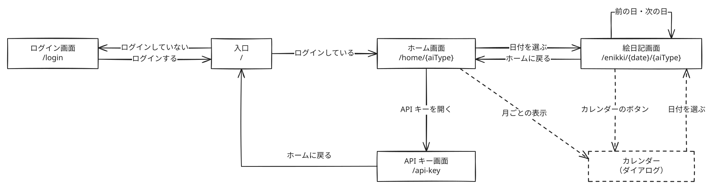
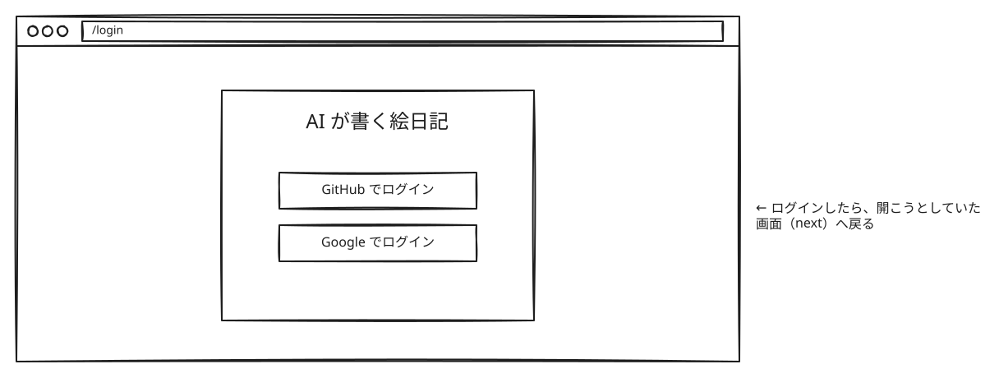
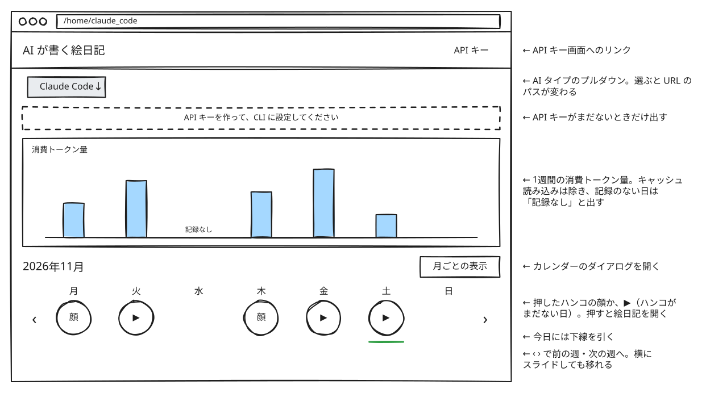
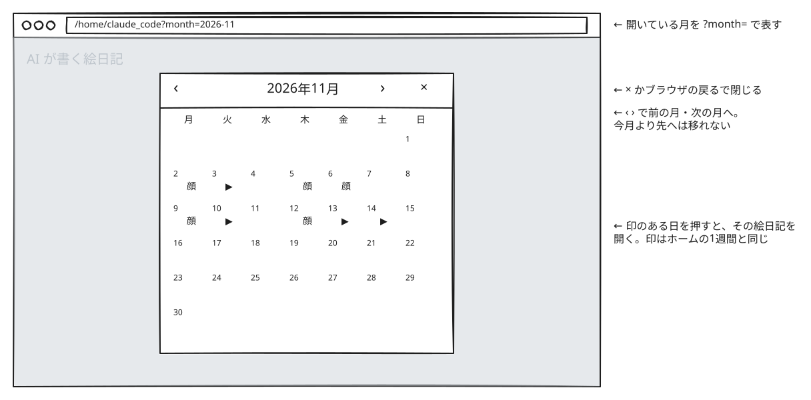
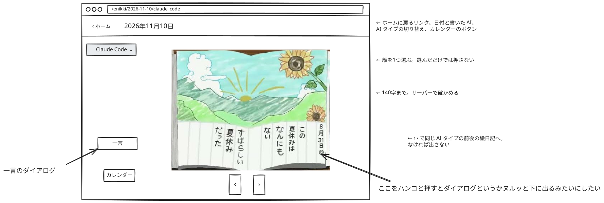
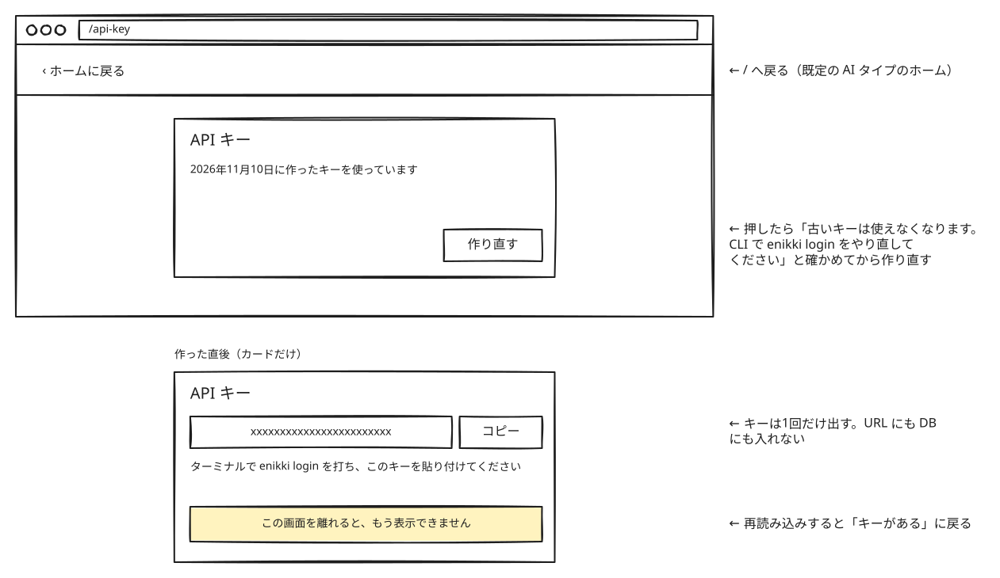

# 画面の設計

Web の画面の URL、遷移、状態をまとめる。ユースケースは [ユースケース](use-cases.md)、ルールは [ドメイン](domain-model.md)、データの読み方は [DB の設計](db-design.md) にある。

## 1. 画面と URL

| URL                                | 画面     | 内容                                                                       |
| ---------------------------------- | -------- | -------------------------------------------------------------------------- |
| `/`                                | （入口） | ログインしていれば `/home/{aiType}` へ、していなければ `/login` へ転送する |
| `/login?next={パス}`               | ログイン | GitHub か Google でログインし、`next` へ戻る（5章）                        |
| `/home/{aiType}?week={月曜の日付}` | ホーム   | 1週間のハンコと消費トークン量。`week` を省くと今週を出す                   |
| `/enikki/{date}/{aiType}`          | 絵日記   | 1件の絵日記と、ハンコと一言                                                |
| `/api-key`                         | API キー | API キーを作る、作り直す                                                   |

- 値の書き方は API とそろえる（`2026-11-10`、`2026-11`、`claude_code` か `codex`）。形が正しくなければ、「ページが見つかりません」を `404` で返す
- `week` に月曜以外の日付が来たら、その日を含む週を出す
- カレンダーは画面にせず、ホームと絵日記の上に開くダイアログにする。開いている月は `?month=2026-11` で表す
- 絵は API の設計のとおり `/images/{date}/{aiType}?v={uuid}` で読む

`/` は DB を見て AI タイプを決める。Claude Code の絵日記があれば `claude_code`、なければ Codex の絵日記があれば `codex`、どちらもなければ `claude_code` にする。ログインした直後も `/` を通る。

## 2. 画面遷移

点線はカレンダーのダイアログに関わる操作を表す。ログインする前に開こうとした画面があれば、ログインしたあとはその画面へ戻る。

## 3. 画面ごとの表示と操作

図は PC で開いたときの部品と並びを表す。見た目は実装で決める。

### ログイン

ログインしたまま開いたら、`next`（なければ `/`）へ転送する。

### ホーム

1週間の列には、日ごとに次の印を出す。

| その日           | 印       | 押すと                           |
| ---------------- | -------- | -------------------------------- |
| ハンコを押した   | 押した顔 | 絵日記を開く                     |
| ハンコがまだない | ▶       | 絵日記を開く。ハンコはそこで押す |
| 絵日記がない     | なし     | 何も起きない                     |

- AI タイプを切り替えても、`week` はそのまま残す
- 今週より先へは移れない。今日は日本時間で決める
- 週が2つの月にまたがるときは、「2026年10月〜11月」と出す
- スマートフォンでは、1週間の列を横にスライドしても週を移れる

### カレンダーのダイアログ

- 最初に開く月は、ホームでは今月、絵日記ではその絵日記の月にする
- 印はホームの1週間の列と同じにする。印のある日を押すと、その絵日記を開く
- 閉じると `month` を外す。月を移っても履歴は積まないので、ブラウザの戻るを1回押せば閉じる

### 絵日記

紙の絵日記のように、1ページに絵と文章を出す。ハンコはページの ◎ から押し、一言は「一言」のボタンから書く。

- ハンコを押すまでは「一言」のボタンを出さない。ハンコを押さずに一言だけを書くことはできない（ドメイン）
- ハンコのパネルは、◎ を押したときやキーボードで選んだときにも開く。タッチの画面とキーボードでは、マウスを乗せられないため
- 書いた一言は、一言のダイアログを開くと見られる
- 絵日記がない日は、「この日の絵日記はありません」を `404` で出す。ホームとカレンダーへは移れる

送ったときにうまくいかなかったら、次のようにする。

| 起きたこと                         | すること                                                                  |
| ---------------------------------- | ------------------------------------------------------------------------- |
| 一言が140字を超えた                | 入力を残したまま、「一言は140字までです」と出す。字数はサーバーで確かめる |
| 別のタブで先にハンコが押されていた | 画面を読み直し、「すでにハンコが押されています」と出す                    |
| セッションが切れていた             | ログイン画面へ転送する（5章）                                             |

### API キー

- キーがまだないときは、説明と「API キーを作る」のボタンを出す
- キーは作った直後に1回だけ出す。URL にも DB にも入れず、DB にはハッシュだけを入れる
- 再読み込みすると、作った日だけの表示に戻る

### ページが見つからない

「ページが見つかりません」と `/` へのリンクを、`404` で出す。

### サーバーが読み書きするもの

各画面の loader と action が読み書きする。読み方と書き方は DB の設計の4章と5章にある。

| 画面       | 読み書きするもの                                                                                    |
| ---------- | --------------------------------------------------------------------------------------------------- |
| `/`        | Claude Code と Codex の絵日記があるか。`enikki` の主キーの先頭（`user_id`、`ai_type`）で1件だけ読む |
| ホーム     | 1週間のハンコと消費トークン量、API キーがあるか                                                     |
| カレンダー | 1か月のハンコ。`month` があるときだけ読む                                                           |
| 絵日記     | 1件の絵日記と、前後の絵日記の日付。ハンコと一言を書く                                               |
| API キー   | キーがあるか、作った日。キーを作る、作り直す                                                        |

## 4. 状態を持つ場所

| 状態                                                       | 持つ場所            | 消えるとき                                           |
| ---------------------------------------------------------- | ------------------- | ---------------------------------------------------- |
| ログインしている利用者                                     | Cookie のセッション | セッションが切れたとき                               |
| 見ている AI タイプと日付                                   | URL のパス          | 別の URL へ移ったとき                                |
| ホームの週、カレンダーの月                                 | URL のクエリ        | 別の URL へ移ったとき、ダイアログを閉じたとき        |
| ログインしたあとの戻り先                                   | URL のクエリ `next` | ログインしたとき                                     |
| パネルやダイアログが開いているか、選んだ顔、書きかけの一言 | React の state      | 送ったとき、別の画面へ移ったとき、再読み込みしたとき |
| 作ったばかりの API キー                                    | action の返り値     | 別の画面へ移ったとき、再読み込みしたとき             |
| 絵日記、ハンコ、一言、消費トークン量、API キーのハッシュ   | D1                  | 消さない                                             |

AI タイプを React の state、localStorage、Cookie に入れないのは、次のことが起きるためだ。

- state と localStorage はサーバーに届かない。サーバーには URL と Cookie しか届かないので、再読み込みすると既定の AI タイプが出てしまう
- Cookie はどのタブにも同じ値が送られる。別のタブで Codex に切り替えると、こちらを再読み込みしたときも Codex が出てしまう

画面の間では、リンクの URL で AI タイプを引き継ぐ。絵日記の「ホーム」は `/home/{aiType}?week={その絵日記の日付}` へ戻る。API キー画面は AI タイプを持たないので、「ホームに戻る」は `/` へ行く。

ハンコのパネルと一言のダイアログは URL に入れない。サーバーから読むものがなく、再読み込みで閉じても困らないためだ。

## 5. ログインしていないとき

- ログインせずに開いたら、`/login?next={開いた URL のパスとクエリ}` へ転送する。ログインしたら `next` へ戻す
- フォームを送ったときにセッションが切れていたら、同じように転送する。選んだ顔や書きかけの一言は残らない
- 画像のルートは、API の設計のとおり `401` を返す
- `next` は、`/` で始まり、2文字目が `/` でも `\` でもない値だけを受け付ける。ほかの値なら `/` へ転送する

`next` に外のサイトの URL を受け付けると、ログインした直後に偽のサイトへ飛ばすリンクを、誰でも作れてしまう（オープンリダイレクト）。`//evil.example` と `/\evil.example` も、ブラウザは別のサイトとして扱う。

## 6. ほかの利用者の絵日記を開こうとしたとき

URL に利用者は入っておらず、サーバーはいつもログインしている利用者の絵日記を読む。ほかの利用者から送られた `/enikki/2026-11-10/claude_code` を開くと、自分の絵日記が出る。なければ「この日の絵日記はありません」が出る。画像も同じ。

## 7. 確かめる場面

| 場面                                                                          | 期待すること                                                                    |
| ----------------------------------------------------------------------------- | ------------------------------------------------------------------------------- |
| Codex だけを使っている人がログインする                                        | `/home/codex` が出る                                                            |
| ホームで ▶ の日を開き、ハンコを押してから一言を書く                          | ◎ が押した顔に変わる。ホームに戻ると、その日の印も押した顔になっている          |
| ハンコを押していない絵日記を開く                                              | 「一言」のボタンが出ない                                                        |
| 2つのタブで Claude Code を開き、右で Codex に切り替えてから左を再読み込みする | 左は Claude Code のまま                                                         |
| セッションが切れたあとに、ブックマークした絵日記を開く                        | ログインすると、同じ絵日記に戻る                                                |
| `/login?next=//evil.example` を開いてログインする                             | `/` へ転送され、外のサイトへは行かない                                          |
| ほかの利用者から送られた絵日記の URL を開く                                   | 自分の絵日記が出る。なければ「この日の絵日記はありません」が出る                |
| 前の週の ▶ から絵日記を開き、「ホーム」を押す                                | その週のホームが出る                                                            |
| 絵日記で ‹ を押し続ける                                                       | 同じ AI タイプの絵日記だけをたどる。いちばん古い絵日記では ‹ が出ない           |
| API キーを作り直す                                                            | 確かめのダイアログが出る。キーは1回だけ出て、再読み込みすると作った日だけになる |
| 一言に141字を書いて送る                                                       | 入力が残ったまま、「一言は140字までです」と出る                                 |

## 8. 実装で確かめること

- void の loader が、クエリ（`week`、`month`）だけが変わったときにも動き直すか
- フォームを送ったあとに再読み込みすると、送り直しになるか。API キーの画面で送り直しになると、知らないうちにキーが作り直されてしまう
- Better Auth のログインで、`next` のパスを戻り先として渡せるか

## 9. 今回はやらないこと

- ログアウト。ユースケースにないため
- 絵日記を共有するボタン。絵日記は持ち主しか見られないため
- 最後に選んだ AI タイプを、次のログインまで覚えておくこと。`/` は DB を見て決める
