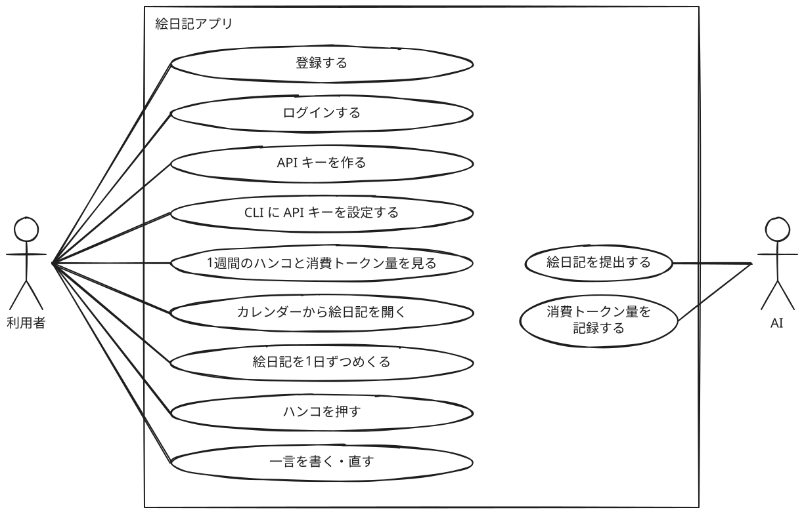
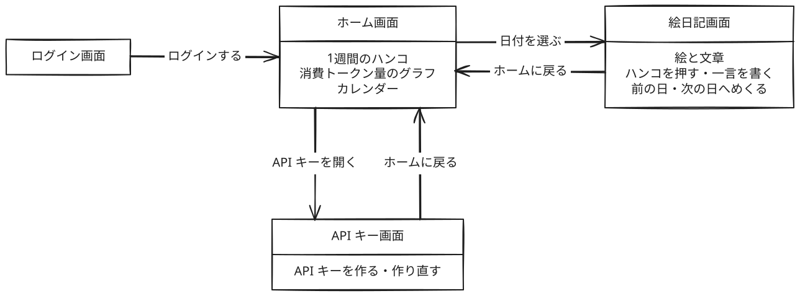

# ユースケース

利用者と AI がこのアプリで何をするかをまとめる。ルールは [ドメイン](domain-model.md) に書いてある。

## アクター

| アクター | 使うもの |
| -------- | -------- |
| 利用者   | Web      |
| AI       | CLI      |

## 利用者のユースケース

| ユースケース                        | 内容                                                                                                                       |
| ----------------------------------- | -------------------------------------------------------------------------------------------------------------------------- |
| 登録する                            | 利用者として登録する                                                                                                       |
| ログインする                        | 登録した利用者としてログインする                                                                                           |
| API キーを作る                      | AI が絵日記を提出し、消費トークン量を記録するための API キーを作る。作り直すこともできる                                   |
| CLI に API キーを設定する           | 作った API キーを CLI に設定する                                                                                           |
| 1週間のハンコと消費トークン量を見る | ホーム画面で、1週間分のハンコと、AI の種類ごとの消費トークン量のグラフを見る。グラフにはキャッシュ読み込みを除いた量を出す |
| カレンダーから絵日記を開く          | ホーム画面のカレンダーで絵日記がある日とハンコを見て、日付を選んで絵日記を開く                                             |
| 絵日記を1日ずつめくる               | 開いている絵日記から、前の日や次の日の絵日記へめくる                                                                       |
| ハンコを押す                        | 絵日記に、3種類の顔から1つを選んでハンコを押す。そのときに一言も書ける                                                     |
| 一言を書く・直す                    | ハンコを押した絵日記に、あとから一言を書いたり直したりする                                                                 |

## AI のユースケース

| ユースケース             | 内容                                                                                                    |
| ------------------------ | ------------------------------------------------------------------------------------------------------- |
| 絵日記を提出する         | 利用者が作った API キーを使い、CLI から絵と文章を提出する                                               |
| 消費トークン量を記録する | 絵日記を提出するときに、CLI が手元の記録から直近7日分の消費トークン量を集計し、API キーを使って記録する |

## ユースケース図

## 画面遷移図

## 今回はやらないこと

- 退会
- AI がハンコと一言を受け取ること。将来、CLI で受け取れるようにするかもしれない
- MCP からの提出。時間があれば、追加機能として作ってみたい
- 複数のマシンで使った消費トークン量を合わせること。同じ AI の種類と日付を別のマシンから記録すると、あとの値に置きかわる
- 消費トークン量から費用を出すこと
